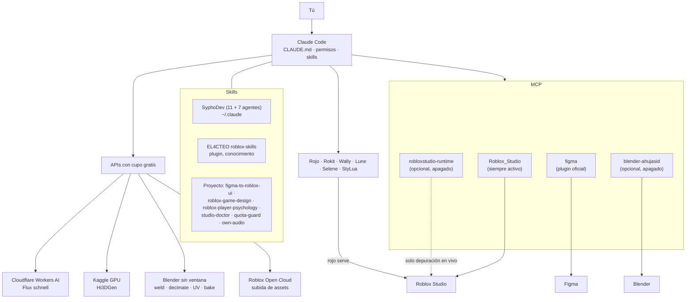

# roblox-ai-studio

Plantilla para crear juegos de Roblox con **Claude Code**, el **MCP oficial de Roblox Studio**,
**Rojo**, **Blender**, **Figma** y un conjunto de skills ya elegido y fijado por commit.
Funciona en Windows (prioridad), macOS y Linux (en Linux, sin Studio).

> Usa este repositorio con **"Use this template"** en GitHub. Cada juego que crees vive en
> `games/<NombreJuego>/` con su propio git.

---

## Inicio rápido: PC nuevo con Windows

Unos 20–40 minutos, casi todo descargas. Las secciones 2 a 4 explican cada paso con detalle.

**1. Git y el repositorio** (PowerShell):

```powershell
winget install --id Git.Git -e
```

Cierra y abre la terminal, y luego:

```powershell
cd $HOME\Desktop
git clone https://github.com/Andres-devp/roblox-ai-studio.git
cd roblox-ai-studio
```

(Si creaste tu copia con "Use this template", usa la URL de tu repositorio).

**2. Todos los programas de una vez.** Acepta las licencias que pida winget:

```powershell
powershell -ExecutionPolicy Bypass -File scripts\install-prereqs.ps1 -Optional
```

Instala Git, VS Code, Python 3.12, Rokit, uv, Blender 4.5 LTS, Roblox Studio y Claude Code.
Con `-Optional` añade Node, ffmpeg, PowerShell 7, shellcheck y GitHub CLI, y además las
extensiones de VS Code.

**3. Inicia sesión en Claude Code una vez.** Ejecuta `claude`, completa el login y sal con `/exit`.

**4. Setup del estudio.** Instala las skills, los plugins y las dependencias de Python, y pregunta por `ROBLOX_GAMES_HOME`:

```powershell
powershell -ExecutionPolicy Bypass -File scripts\setup.ps1
```

Termina con la tabla de `doctor.py`: no debe quedar ninguna fila ❌.

**5. Claves**, con `setx` en tu terminal, **nunca en el chat** (sección 3):

```powershell
setx ROBLOX_API_KEY "..."
setx ROBLOX_USER_ID "..."
setx CF_ACCOUNT_ID "..."
setx CF_API_TOKEN "..."
setx KAGGLE_API_TOKEN "..."
```

**6. Roblox Studio:**
- Inicia sesión.
- Assistant → **…** → **Manage MCP Servers** → **Enable Studio as MCP server**.
- Deja **Script Sync** apagado.

**7. Abre una terminal nueva** (para que lea las variables) y arranca Claude:

```powershell
cd $HOME\Desktop\roblox-ai-studio
claude
```

Dentro de Claude:
- Acepta la confianza de la carpeta.
- `/mcp` → **figma** → autenticar.
- `/roblox-skills-setup`: escribe los `LOCAL.md` de las skills de SyphoDev.
- Comprueba Studio pidiendo: *"llama a list_roblox_studios y get_studio_state"*.

**8. Primer juego:**

```text
complete the research and plan stage for an obby game
```

Al cerrar la sección, escribe "approved". Cuando crees el primer juego, ejecuta dentro de
su carpeta `rokit install`, `wally install` y `rojo plugin install` (ver [games/README.md](games/README.md)).

Si algo falla: `python scripts/doctor.py`, o dile a Claude *"algo falla con Studio"*.

---

## 1. Qué es y cómo funciona

Claude Code es el agente. Lee `CLAUDE.md`, elige la skill adecuada para cada tarea y habla
con Studio, Figma y Blender por MCP. El código vive en disco y llega a Studio con Rojo.
Los assets se generan con servicios gratis cuyo cupo vigila `quota-guard`.



### Las 6 secciones de `create-roblox-game`

La skill `create-roblox-game` (SyphoDev) lleva un juego de la idea a publicado en 6
secciones, **una por sesión**:

1. **Investigación y plan:** mercado, género y un documento de diseño.
2. **Código:** proyecto Rojo y sistemas, con las 4 revisiones en verde.
3. **Arte:** mapa, modelos, texturas, UI y VFX.
4. **Animación y sonido.**
5. **Playtest.**
6. **Publicar.**

Al cerrar cada sección se escribe `HANDOFF.md`. Para pasar a la siguiente escribe
**"approved"**; después puedes limpiar el chat y continuar en otra sesión.

Más detalle en [docs/pipeline.md](docs/pipeline.md).

---

## 2. Programas

En Windows, `scripts\install-prereqs.ps1` instala todo esto de una vez (con `-Optional`, también los
opcionales). Ejecútalo tú en tu terminal: winget te pide aceptar la licencia de cada paquete.

| Programa | Tipo | Para qué sirve | Windows (winget) / enlace |
|---|---|---|---|
| Git | Obligatorio | Control de versiones | `winget install Git.Git` |
| VS Code | Obligatorio | Editor; extensiones de Rojo, luau-lsp, Selene y StyLua | `winget install Microsoft.VisualStudioCode` |
| Python 3.11+ | Obligatorio | Scripts de las skills, setup, doctor | `winget install Python.Python.3.12` |
| Rokit | Obligatorio | Instala la toolchain de cada juego (rojo, wally, lune, selene, stylua) | `winget install Rojo.Rokit` (el setup ejecuta después `rokit self-install`) |
| Claude Code | Obligatorio | El agente | `irm https://claude.ai/install.ps1 \| iex` (se actualiza solo) o `winget install Anthropic.ClaudeCode` |
| Roblox Studio | Obligatorio | El motor; trae el MCP oficial | `winget install Roblox.RobloxStudio` o https://create.roblox.com/docs/studio/setup |
| Blender 4.x | Obligatorio | Modelos y animación sin ventana | `winget install BlenderFoundation.Blender.LTS.4.5` |
| uv | Obligatorio | Ejecuta `uvx` (MCP de Blender) | `winget install astral-sh.uv` |
| Node LTS | Opcional | `npx` para `robloxstudio-runtime`; ruta "hard-surface" de 3D | `winget install OpenJS.NodeJS.LTS` |
| ffmpeg | Opcional | Convertir y normalizar audio (`own-audio`), vistas previas | `winget install Gyan.FFmpeg` |
| Moon Animator 2 | Opcional | Retoques de animación dentro de Studio | Plugin de la Creator Store |
| GitHub CLI | Opcional | Crear un repositorio para cada juego (`gh repo create`) | `winget install GitHub.cli` |
| Gemini CLI / Antigravity CLI | Opcional | Respaldo si se agota Claude (cupo no verificado: ver `docs/quotas.md`) | https://geminicli.com |

En macOS usa los instaladores de cada enlace (o `brew install git python uv ffmpeg node`).
Para Rokit, mira https://github.com/rojo-rbx/rokit.

---

## 3. Cuentas y claves

| Cuenta | Para qué | Qué necesitas |
|---|---|---|
| **Claude Pro** | Claude Code | Iniciar sesión en `claude` |
| **Roblox** | Studio y publicar | Una **clave de Open Cloud** con permiso de **Assets** (lectura y escritura), creada en Creator Dashboard → Credentials |
| **Figma Education** | Diseño de UI con el MCP | Asiento Dev o Full (200 llamadas al día) |
| **Cloudflare** | Imágenes e iconos con Flux | **Account ID** + un **token de API** con permiso de Workers AI |
| **Kaggle** | GPU para imagen → 3D | **Teléfono verificado** (sin él no hay GPU) + token de API (kaggle.com → Settings → API) |
| Hugging Face (opcional) | Respaldo 3D con ZeroGPU | Token de lectura |

### Variables de entorno

> ⚠️ **Nunca pegues una clave en el chat ni en un archivo del repositorio.** Ponlas tú
> en tu propia terminal. En los archivos solo se escriben los **nombres** de las variables.

| Variable | Valor |
|---|---|
| `ROBLOX_API_KEY` | Clave de Open Cloud (Assets) |
| `ROBLOX_USER_ID` **o** `ROBLOX_GROUP_ID` | Dueño de las subidas (tu usuario o un grupo) |
| `CF_ACCOUNT_ID`, `CF_API_TOKEN` | Cloudflare Workers AI |
| `KAGGLE_API_TOKEN` | Token de Kaggle (o el archivo `~/.kaggle/kaggle.json`) |
| `HF_TOKEN` | Hugging Face (opcional) |
| `ROBLOX_GAMES_HOME` | `<repo>/games` (el setup ofrece ponerla) |
| `BLENDER`, `KILN_HOME`, `ROBLOX_VFX_LIB` | Opcionales: ruta de Blender, ruta de Kiln, librería de VFX |

**Windows** (PowerShell o cmd; luego abre una terminal nueva):

```powershell
setx ROBLOX_API_KEY "pega-aqui-tu-clave"
setx ROBLOX_USER_ID "123456789"
setx CF_ACCOUNT_ID "tu-account-id"
setx CF_API_TOKEN "tu-token"
setx KAGGLE_API_TOKEN "tu-token"
```

**macOS / Linux** (añádelo a `~/.zshrc` o `~/.bashrc` y abre una terminal nueva):

```bash
export ROBLOX_API_KEY="pega-aqui-tu-clave"
export ROBLOX_USER_ID="123456789"
export CF_ACCOUNT_ID="tu-account-id"
export CF_API_TOKEN="tu-token"
export KAGGLE_API_TOKEN="tu-token"
```

`python scripts/doctor.py` dice si cada variable está "configurada" o "falta", sin mostrar nunca su valor.

---

## 4. Configuración inicial paso a paso

1. En GitHub: **Use this template** → crea tu repositorio → clónalo.
2. Instala los programas obligatorios (sección 2).
   - En Windows: `powershell -ExecutionPolicy Bypass -File scripts\install-prereqs.ps1`.
   - Inicia sesión en Claude Code una vez: `claude` y luego `/exit`.
3. Ejecuta el setup. Se puede repetir sin miedo.

   ```powershell
   powershell -ExecutionPolicy Bypass -File scripts\setup.ps1
   ```
   ```bash
   bash scripts/setup.sh
   ```

   El setup hace lo siguiente:
   - clona las skills fijadas en `vendor/`;
   - instala SyphoDev en `~/.claude` y parcha sus agentes;
   - copia las skills de proyecto;
   - instala los plugins;
   - instala las dependencias de Python;
   - te **pregunta** si configura `ROBLOX_GAMES_HOME`;
   - ejecuta `doctor.py`.
4. **En Roblox Studio:**
   - Assistant → **…** → **Manage MCP Servers** → **Enable Studio as MCP server**.
   - **Script Sync apagado.** Usamos Rojo.
   - Plugin de Rojo: dentro de un juego, después de `rokit install`, ejecuta `rojo plugin install`.
5. **En Claude Code** (`claude` en la raíz del repo):
   - Acepta la confianza de la carpeta. Sin eso no se aplican el MCP aprobado ni los plugins del proyecto.
   - `/mcp` → **figma** → autenticar.
   - `/roblox-skills-setup`: escribe el `LOCAL.md` de cada skill de SyphoDev (rutas, Blender, librería de VFX).
6. **Comprueba:**
   - `python scripts/doctor.py` sin filas ❌.
   - En Studio, el indicador del MCP en **verde**.
   - En Claude, pide: "llama a list_roblox_studios y get_studio_state".

---

## 5. Tu primer juego

Prompts exactos que activan `create-roblox-game`, cada uno en una sesión:

```text
complete the research and plan stage for an obby game
```
```text
approved
```
```text
continue with the development of the obby game
```

Ve repitiendo "continue with the development of the obby game" y "approved" para cada sección.

Skills sueltas, en cualquier momento:

```text
usa roblox-ui para un HUD de monedas
usa roblox-map para un mapa de duelo pequeño con dos plataformas y un puente
usa roblox-3d-model para un cofre del tesoro low-poly
usa figma-to-roblox-ui para importar el frame "Shop" de mi archivo de Figma
usa own-audio para subir los WAV de games/ObbyRush/assets/audio/source
¿cuánto cupo me queda?            (quota-guard)
el MCP de Studio no responde      (studio-doctor)
```

---

## 6. Flujo diario

1. Abre Studio con el lugar del juego.
2. En la carpeta del juego, ejecuta `rojo serve`. Conecta **una vez** el plugin de Rojo en Studio y **acepta** el aviso de conexión.
3. Da Play y comprueba en **Output** la **marca de build** (build stamp). Si no aparece, Studio corre código viejo.
4. Ejecuta `claude` en la raíz del repo y trabaja.
5. Antes de cada commit, pasa las 4 revisiones:
   ```bash
   python ~/.claude/skills/roblox-code/scripts/check.py
   ```
   Son `rojo build`, `lune run test`, `selene` y `stylua`; deben salir todas en verde.
6. Haz el commit en el repositorio del juego.

---

## 7. Límites gratis y cómo no bloquearse

| Servicio | Cupo gratis | Reinicio |
|---|---|---|
| Cloudflare Workers AI | 10.000 neurons/día (~70 imágenes de 1024 px) | 00:00 UTC |
| Kaggle GPU | ~30 h/semana (mira tu cuenta), ~100 s por modelo | Semanal |
| HF ZeroGPU | 5 min/día | 24 h tras el primer uso |
| Figma MCP | Education 200/día y 10/min; View/Collab 20/mes | Diario |
| Studio procedurales | 50 en 24 h | Ventana móvil |
| Open Cloud audio | 100/mes (cifra conservadora) | 30 días |
| Claude Pro | Compartido entre chat y Claude Code | Cada pocas horas |

Cifras, fuentes y fechas de verificación: [docs/quotas.md](docs/quotas.md). Claude usa la
skill **`quota-guard`** antes de cada llamada con cupo: estima, te pregunta si se va a
pasar y propone el respaldo (por ejemplo Cloudflare → Kaggle → Pollinations para imágenes).

---

## 8. Reglas de oro

1. **El disco es la verdad.** Se edita en disco; Studio recibe por Rojo. Nada se edita a mano dentro de Studio.
2. **Un solo servidor MCP de Studio y una sola conexión de Rojo.** Dos de cualquiera de los dos lo duplican o lo bloquean todo.
3. **Nunca secretos en archivos.** Solo variables de entorno; nunca en el chat.
4. **Revisa el interruptor del MCP después de cada actualización de Studio.** A veces se apaga solo.

---

## 9. Solución de problemas

| # | Síntoma | Arreglo rápido |
|---|---|---|
| 1 | Claude no ve Studio | Interruptor "Enable Studio as MCP server" encendido; `/mcp` en Claude; reinicia Studio y Claude |
| 2 | El MCP se cae cada pocos minutos | Apaga y enciende el interruptor en Studio (fallo conocido) |
| 3 | Scripts y módulos duplicados | Hay dos conexiones de Rojo: desconecta todo y conecta una vez |
| 4 | Los cambios no llegan a Studio | Acepta el aviso de conexión de Rojo; comprueba la marca de build |
| 5 | `uvx`/`npx` dan `ENOENT` en Windows | Ya van envueltos en `cmd /c`; abre una terminal nueva tras instalar uv |
| 6 | Kaggle no da GPU | Verifica tu teléfono en Kaggle |
| 7 | Figma Education limita como View/Collab | `whoami` en el MCP de Figma, revisa el equipo del archivo, reautentica; si no, soporte de Figma |
| 8 | Una skill pide `LOCAL.md` | `/roblox-skills-setup` |

Todo lo demás está en [docs/troubleshooting.md](docs/troubleshooting.md). Dentro de Claude
Code basta con decir "algo falla con Studio": se activa la skill **`studio-doctor`**.

---

## 10. Actualizar las skills

```powershell
powershell -ExecutionPolicy Bypass -File scripts\update-skills.ps1
```
```bash
bash scripts/update-skills.sh
```

Para cada fuente, el script:

1. Trae el último commit (o el último tag, en el plugin de EL4CTEO).
2. Muestra `git log --oneline <fijado>..<nuevo>` y el resumen de archivos cambiados.
3. **Pregunta** antes de mover el commit fijado en `skills.lock.json`.
4. Si cambió algo, vuelve a ejecutar el setup.

Revisa el diff y haz commit del lock.

---

## 11. Créditos y licencias

Las skills de **SyphoDev** (https://www.youtube.com/@SyphoDev), **EL4CTEO**, **xtrair** y
**TabooHarmony**, el plugin de **Figma** y los MCP de **ahujasid** y **Chrrxs** son de sus
autores. Este repositorio no copia su contenido: lo descarga del original en el commit fijado.

- Créditos y licencias: [THIRD_PARTY.md](THIRD_PARTY.md).
- Obligaciones al publicar un juego: [docs/licenses.md](docs/licenses.md).
- Lo propio de esta plantilla es MIT ([LICENSE](LICENSE)).
