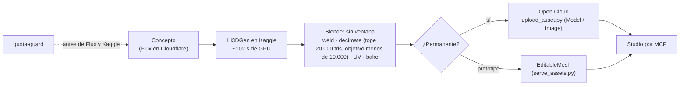
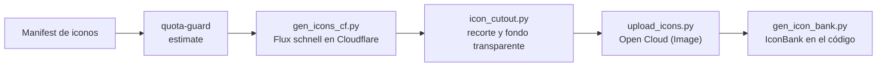
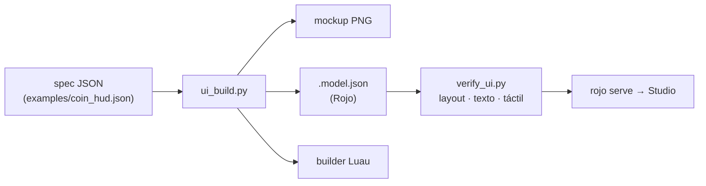
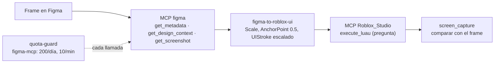
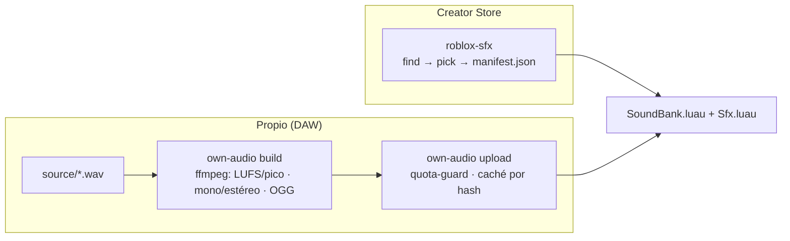

# Pipeline: de la idea al juego publicado

`create-roblox-game` (SyphoDev) es la puerta de entrada. Lleva un juego por 6 secciones,
**una por sesión**, con `HANDOFF.md` entre secciones y la palabra "approved" para cerrar cada una.

```mermaid
flowchart LR
    S1["1 · Investigación y plan"] --> S2["2 · Código"]
    S2 --> S3["3 · Arte"]
    S3 --> S4["4 · Animación y sonido"]
    S4 --> S5["5 · Playtest"]
    S5 --> S6["6 · Publicar"]
    S1 -. HANDOFF.md + approved .-> S2
```

| Fase | Skill principal | Apoyo |
|---|---|---|
| Investigación y plan | `create-roblox-game` (sección 1) | `roblox-game-design`, `roblox-player-psychology`, agente `roblox-market-scout` |
| Código | `roblox-code` (4 revisiones: `rojo build`, `lune run test`, `selene`, `stylua`) | `roblox-skills:roblox-luau`, `roblox-networking`, `roblox-security`, `roblox-data-stores` |
| Mapa | `roblox-map` (spec → greybox → prover) | `roblox-skills:roblox-world-building` |
| Modelos 3D | `roblox-3d-model` | `roblox-texture-gen`, `quota-guard` |
| UI | `roblox-ui` (desde spec) · `figma-to-roblox-ui` (desde Figma) | MCP `figma`, `quota-guard` |
| VFX | `roblox-vfx` (librería de packs propios) | `docs/licenses.md` |
| Animación | `roblox-animation` (Blender sin ventana) | — |
| Sonido | `roblox-sfx` (Creator Store) · `own-audio` (propio) | `quota-guard` |
| Ensamblar en Studio | `create-roblox-game` + MCP `Roblox_Studio` | `roblox-skills:roblox-studio-mcp` |
| Playtest y publicar | `create-roblox-game` (secciones 5 y 6) | `studio-doctor` si algo falla |

`roblox-build-orchestrator` puede lanzar en paralelo las fases de assets con los 7 agentes. Los agentes trabajan en disco y nunca tocan Studio; el hilo principal ensambla.

## 3D: imagen → modelo en Studio



- Respaldos de la malla: Space de Hugging Face (`image_to_3d.py`) → `generate_mesh` de Studio.
- Para una textura se sube un `Image`, no un `Decal`: un Decal tiene otro ID y el modelo queda gris. Lo explica `upload_asset.py`.
- Hunyuan3D no se usa: su licencia excluye la UE, el Reino Unido y Corea del Sur (ver `docs/licenses.md`).

## Iconos: Flux → recorte → subida



## UI desde spec



## UI desde Figma



Al terminar, pasa la UI a disco: el disco es la verdad, así que lo que se construyó en Studio por MCP se exporta a `.model.json` o a un builder Luau dentro del proyecto Rojo.

## Sonido


